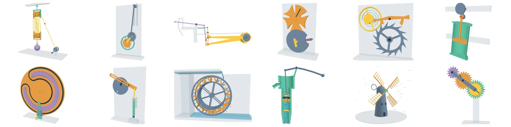

<h1 align="center">mechanisms.wiki</h1>

<p align="center">
  <b>Mechanical movements as 3D models you can turn, take apart and operate.</b><br>
  All 507 movements from Henry T. Brown's <i>Five Hundred and Seven Mechanical Movements</i> (1868), rebuilt in the browser.
</p>

<p align="center">
  
</p>

<p align="center">
  <a href="LICENSE"></a>
  
  
  <a href="CONTRIBUTING.md"></a>
</p>

---

## What it is

In 1868 Henry T. Brown published 507 small engravings of the mechanisms that made the industrial world move:
gears, cranks, cams, ratchets, escapements, pumps, engines. Each came with a few lines of text. They are
beautiful, but a drawing cannot show motion.

mechanisms.wiki turns every one of them into a live model:

- **It really moves.** Motion comes from the kinematics (gear ratios, linkage geometry, cam profiles), not from keyframes.
- **You can take it apart.** Turn it, zoom in, pick a part to see what it does, open or close the casing.
- **One control that teaches.** Each model has a slider or a choice that shows the idea: change the bend, add pulleys, raise the pressure.
- **Plain words.** Every page explains what you see and why, written for a curious 12-year-old. Brown's original text sits beside it.
- **Honest.** Where a support, a size or a tooth count had to be invented, the page says so.

## Run it

There is no build step and no server code. Serve the folder with any static server:

```sh
git clone https://github.com/avsthiago/mechanisms-wiki.git
cd mechanisms-wiki
python3 -m http.server 8000
```

Then open <http://localhost:8000>.

| Address | Page |
|---|---|
| `index.html` | Contents: search, families, a card for every movement |
| `index.html#m53` | One movement (here No. 53) |
| `index.html#index` | Brown's own index, A to Z |
| `index.html#about` | About |

## How it is organised

```
index.html              the one page; routed by the address hash
engine/engine.js        page shell, controls, camera, render loop
engine/parts.js         shared geometry: gears, racks, cams, pulleys, belts, springs...
engine/engine.css       all styling
movements/NNN/          one movement.js per movement; _template/ is a working start
data/movements.js       titles, families and Brown's text for every movement
data/index.js           Brown's index
ref/NNN.png             Brown's engravings, cleaned from a scan of the book
thumbs/NNN.webp         card pictures for the contents page
scripts/                screenshot check, card pictures, engraving cutter
vendor/                 three.js r128 and OrbitControls
```

A movement is a single call:

```js
M507.define({
  number: 24,
  title: "Spur gears",
  parts: [ /* 3 to 6 parts, each with a colour and a note */ ],
  controls: [ /* the one control that teaches */ ],
  build: function (c) { /* make the meshes once */ },
  step: function (c, dt, S) { /* move them by dt seconds */ }
});
```

The full contract, the modelling rules and the writing style are in [`CLAUDE.md`](CLAUDE.md).

## Contributing

Corrections are the most useful help: a model that moves wrongly, a part that floats, a sentence a student
would not understand, or a gap between the model and Brown's engraving. See [CONTRIBUTING.md](CONTRIBUTING.md).

## License

[MIT](LICENSE). This covers the code, the models and the written explanations.
Brown's own text and engravings are public domain and stay so.

## Credits

- Text and engravings: Henry T. Brown, *Five Hundred and Seven Mechanical Movements*, 1868. Public domain.
- 3D rendering: [three.js](https://threejs.org) r128 (MIT, see `vendor/THREE-LICENSE`).
- Typeface: [Atkinson Hyperlegible](https://brailleinstitute.org/freefont), Braille Institute.
